# Product Analytics & A/B Testing Platform

An end-to-end product experimentation and decision-support platform built with Python, SQL, statistical hypothesis testing, and Streamlit.

**[Launch Interactive Dashboard](https://appuct-analytics-ab-testing-platform-ej88f8cdwvqgkixj6aqu4x.streamlit.app/)** | **[View Source Code](https://github.com/Avnisharma28/product-analytics-ab-testing-platform)**

## Project Overview

Product teams need reliable evidence before launching new features. This project demonstrates how A/B testing can help evaluate product changes, quantify conversion uplift, validate experiment quality, and support rollout decisions.

The platform analyzes a simulated experiment with 1,000 users across control and treatment groups.

It combines statistical analysis, interactive visualizations, experiment monitoring, and business decision support in a five-tab dashboard.


## Dashboard Preview

Explore the five-tab interactive dashboard, including statistical analysis, data validation, experiment monitoring, and business decision support.

### 1. Experiment Overview

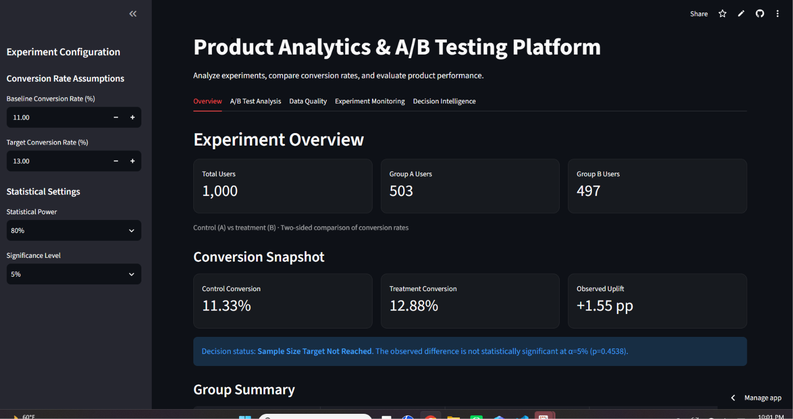

### 2. A/B Test Analysis

**Conversion Performance**

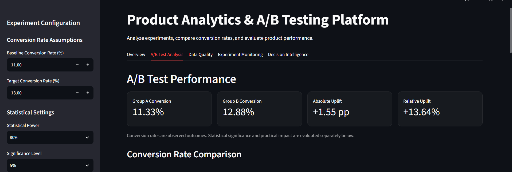

**Conversion Rate Comparison**

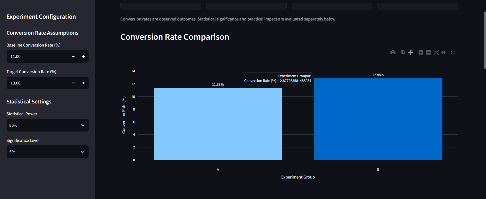

**Statistical Significance**

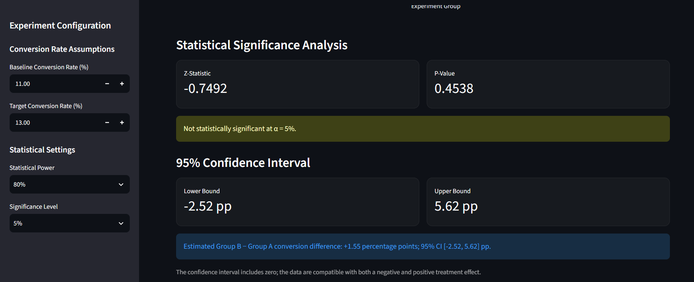

### 3. Data Quality

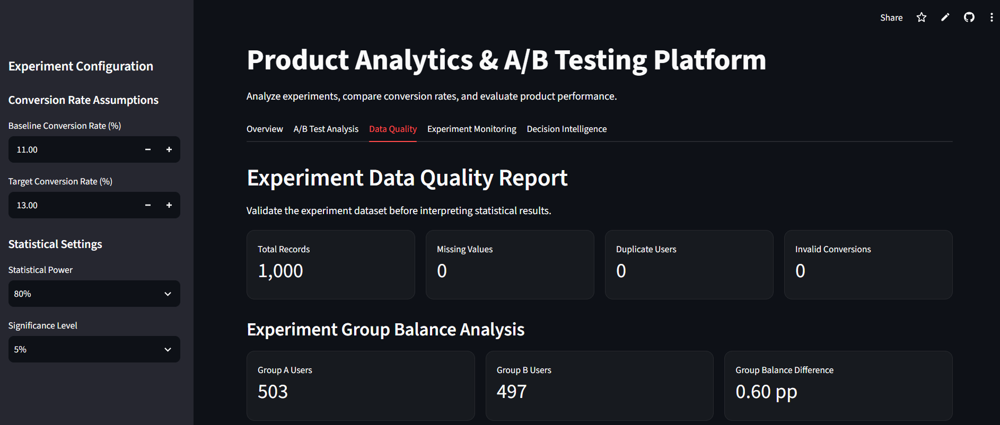

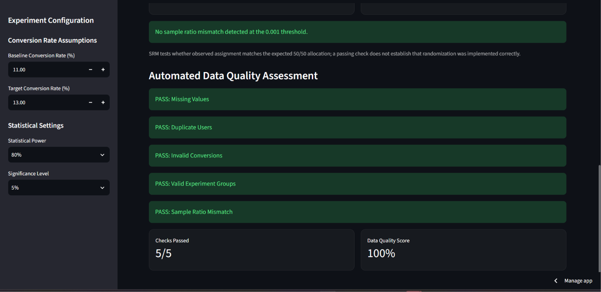

### 4. Experiment Monitoring

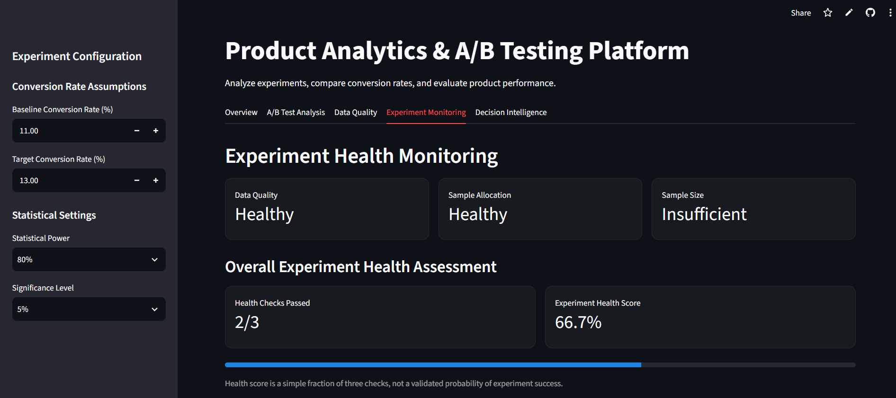

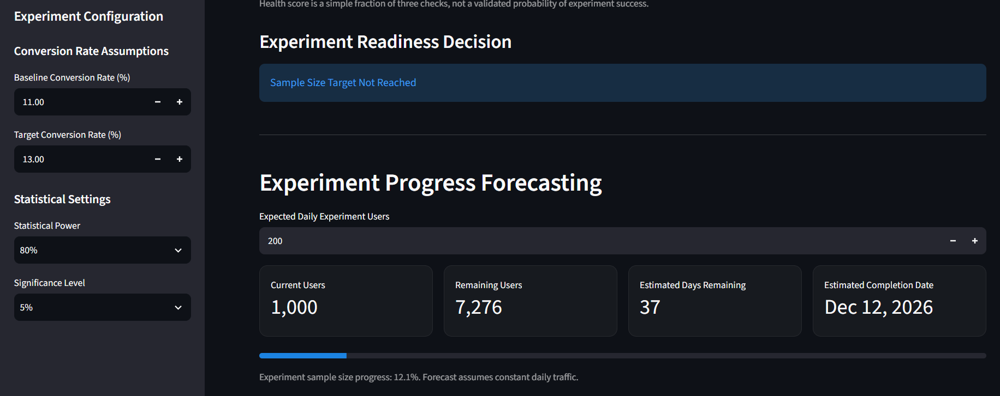

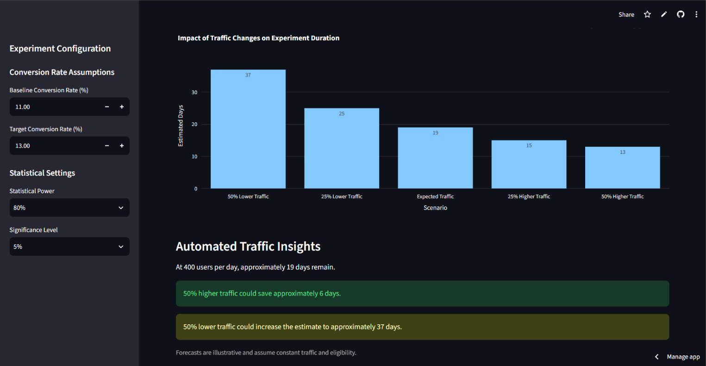

### 5. Decision Intelligence

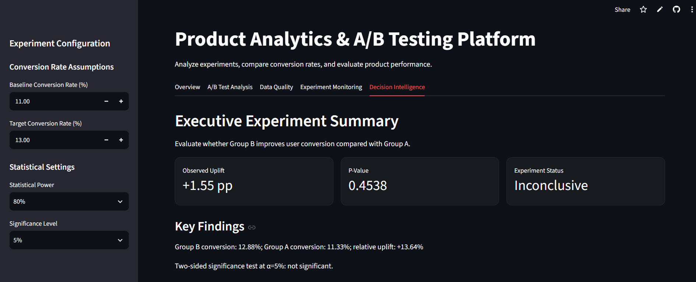

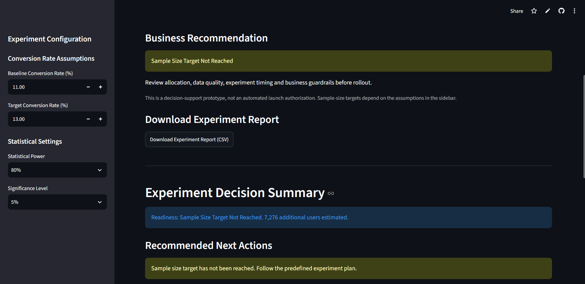

---


## Business Problem

A product team wants to determine whether a proposed product change improves user conversion.

The analysis addresses four questions:

1. Does the treatment improve conversion compared with the control?
2. Is the observed improvement statistically significant?
3. Are experiment allocation and data quality acceptable?
4. Is there enough evidence to recommend launching the treatment?

## Key Experiment Results

| Metric | Result |
|---|---|
| Total users | 1,000 |
| Control users | 503 |
| Treatment users | 497 |
| Control conversion rate | 11.33% |
| Treatment conversion rate | 12.88% |
| Absolute uplift | +1.55 percentage points |
| Relative uplift | +13.64% |
| Two-sided p-value | 0.4538 |
| 95% confidence interval | [-2.52, +5.62] percentage points |
| SRM p-value | 0.8495 |
| Required users per group | 4,138 |
| Total planned sample size | 8,276 |

Sample-size planning assumes an 11% baseline conversion rate, 13% target conversion rate, 80% statistical power, 5% significance level, and equal group allocation.

### Business Interpretation

Although treatment Group B has a higher observed conversion rate, the result is not statistically significant at the 5% level.

The confidence interval includes zero, indicating that the experiment data remain compatible with both negative and positive treatment effects.

The experiment has not reached its planned sample size.

**Recommendation:** Continue according to the predefined experiment plan, monitor allocation and data quality, and avoid making a rollout decision based solely on the observed uplift.

These results are based on simulated data and are intended to demonstrate an experimentation workflow.

## Dashboard Features

### 1. Experiment Overview

- Experiment participation and group allocation
- Control and treatment conversion rates
- Absolute conversion uplift
- Group-level performance summary
- Experiment dataset preview

### 2. A/B Test Analysis

- Conversion rate comparisons
- Absolute and relative uplift
- Two-proportion z-test
- P-value and statistical significance
- Confidence interval visualization
- Sample-size and power analysis
- Interactive experiment planner
- Sample-size sensitivity analysis

### 3. Data Quality

- Missing-value detection
- Duplicate user detection
- Conversion-value validation
- Experiment group validation
- Sample Ratio Mismatch (SRM) detection
- Automated data-quality assessment

### 4. Experiment Monitoring

- Experiment health monitoring
- Sample-size readiness
- Experiment progress forecasting
- Traffic scenario simulation
- Estimated experiment completion timelines

### 5. Decision Intelligence

- Executive experiment summary
- Key experiment findings
- Business recommendations
- Experiment guardrail checks
- Downloadable experiment report

## Statistical Methodology

The statistical analysis is implemented through reusable functions in `src/ab_testing.py`.

| Function | Purpose |
|---|---|
| `calculate_conversion_rate()` | Calculate conversions divided by users |
| `calculate_uplift()` | Calculate relative conversion uplift |
| `calculate_p_value()` | Perform a two-sided two-proportion z-test |
| `calculate_confidence_interval()` | Calculate a Newcombe confidence interval for the conversion-rate difference |
| `calculate_srm_p_value()` | Test allocation balance using a chi-square goodness-of-fit test |
| `calculate_sample_size()` | Estimate sample size per group using statistical power analysis |

The dashboard distinguishes observed conversion improvements from statistical evidence and sample-size readiness.

## Technology Stack

- **Python:** Statistical analysis and application logic
- **Pandas and NumPy:** Data manipulation
- **SciPy:** Statistical testing
- **Statsmodels:** Hypothesis testing, confidence intervals, and power analysis
- **Streamlit:** Interactive dashboard
- **Plotly:** Data visualization
- **SQL:** Experiment analysis queries
- **Pytest:** Automated statistical function tests
- **Git and GitHub:** Version control
- **Streamlit Community Cloud:** Application deployment

## Project Structure

```text

product-analytics-ab-testing-platform/
|-- .github/
|   `-- workflows/
|       `-- python-tests.yml
|-- dashboard/
|   `-- app_fixed.py
|-- data/
|   `-- ab_test_users.csv
|-- docs/
|   `-- screenshots/
|       `-- overview.png
|       `-- ... (other dashboard screenshots)
|-- sql/
|   `-- experiment_analysis.sql
|-- src/
|   |-- ab_testing.py
|   |-- generate_data.py
|   `-- run_sql.py
|-- tests/
|   `-- test_ab_testing.py
|-- requirements.txt
`-- README.md

```

## Running Locally

Clone the repository:

```bash
git clone https://github.com/Avnisharma28/product-analytics-ab-testing-platform.git
cd product-analytics-ab-testing-platform
```

Install dependencies:

```bash
python -m pip install -r requirements.txt
```

Launch the dashboard:

```bash
python -m streamlit run dashboard/app_fixed.py
```

## Automated Testing

The project includes 14 automated tests covering conversion rates, uplift, statistical significance, confidence intervals, sample ratio mismatch, and sample-size estimation.

Run the tests:

```bash
python -m pytest tests/test_ab_testing.py -v
```

Latest locally verified result: **14 tests passed**.
### Continuous Integration

GitHub Actions automatically runs the 14 statistical unit tests on pushes and pull requests to the main branch.

Latest verified GitHub Actions result: **14 tests passed**.
## Future Improvements

- Automated testing through GitHub Actions
- Support for multiple experiments
- Integration with production data warehouses
- Additional product guardrail metrics
- Sequential testing methods with appropriate error control
- Automated experiment reporting pipelines

## Project Scope

This is a portfolio and decision-support prototype using simulated experiment data. It demonstrates practical skills in product analytics, experimentation, statistical reasoning, SQL, Python, testing, and interactive dashboard development.

The application is not an automated production rollout system.

---

**[Explore the Live Dashboard](https://appuct-analytics-ab-testing-platform-ej88f8cdwvqgkixj6aqu4x.streamlit.app/)**
